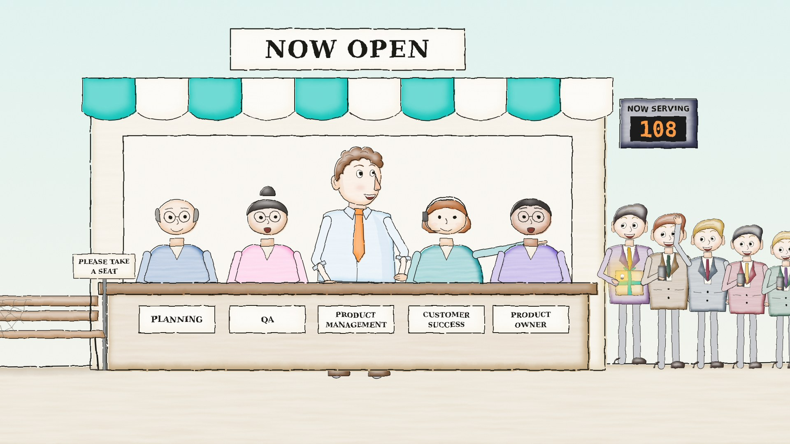

# STAEDEAN CAST

Start with the [canonical character profiles and casting rules](docs/CAST.md) and the repository's [current handoff](../../docs/CURRENT_HANDOFF.md). The ninja is the silent enemy; the sheep is an occasional gag, not a universal mascot. The original build/story overview below is historical where its look, durations or selected cuts differ from the current handoff.

The characters, sets, look and sound behind STAEDEAN's animated shorts, as code. Every drawing in the films comes from this repo, so the cast stays the same from shot to shot, film to film, and between people and AI models working on it.



## The films so far

| # | Film | Length | Story |
|---|---|---|---|
| 1 | **Mount Staedean** | 2:01 | A PM carries a bright idea up a 20,000 m mountain of checkpoints. At the summit the idea is dead and the customer asks "Who are you?". [Story and shots](docs/FILM1_MOUNT_STAEDEAN.md) |
| 2 | **The Door** | 0:49 | The same PM walks 20 m to the customer instead. Weekly visits, fast failures, a handshake, a catapult over the mountain, and everyone serving customers together. [Story and shots](docs/FILM2_THE_DOOR.md) |

The finished films are not in git (they are large). Keep them in a release, SharePoint or Git LFS.

## Start here

| Read | For |
|---|---|
| [docs/CAST.md](docs/CAST.md) | Every character and prop: design, colours, rules, how to draw them |
| [docs/STYLE.md](docs/STYLE.md) | The look, timing, words, sound and humour, plus a continuity checklist |
| [docs/AI_HANDOFF_PROMPT.md](docs/AI_HANDOFF_PROMPT.md) | A brief to paste into another AI assistant before it touches the repo |
| `assets/sheets/` | Model sheets for the whole cast |
| `assets/stills/` | One frame from every shot of both films |

## Draw something

```python
# from src/
import os; os.environ["MS_STYLE"] = "marker"
import cast
from render import render

art  = cast.pm(700, 900, pose="walk", mood="delighted", bulb=1.0, phase=0.8)
art += cast.customer(1250, 890, pose="wave", mood="happy")
render([("hello", cast.frame(art))], "out")       # writes out/hello.png
```

## Build the films

You need Python 3.10+, `pip install -r requirements.txt`, `playwright install chromium` and ffmpeg.

```bash
make setup     # install
make sheets    # re-render the cast model sheets
make check2    # one test frame per shot of film 2 (fast)
make film2     # full film 2 to build/the_door.mp4 (a few minutes)
make film1     # full film 1 to build/mount_staedean.mp4 (about 15 minutes)
```

Partial renders: `cd src && MS_STYLE=marker python3 film2.py V2` redraws only shots whose name starts with `V2`.

## How the code fits together

| Layer | Files | What it does |
|---|---|---|
| Front door | `cast.py` | One simple call per character, prop and mood. Start here. |
| Puppets | `rig.py`, `props.py` | The PM, the idea bulb, the customer, officials, booths, bench, bubbles, signposts |
| Places | `sets.py`, `office.py` | The office, Mount Staedean, ledges, the fork, the summit |
| Film 1 | `film.py`, `film_sound.py`, `anim_office.py`, `story.py` | Shots with timings, drawings and sound cues |
| Film 2 | `film2.py`, `film2_sound.py` | Same, plus the door, the Maker, prototypes, catapult, shop |
| Look | `rb.py` | Line, colour and felt-tip marker looks. Colour mapping and brand colours. |
| Sound | `sfx.py` | Synth library: plucks, bells, mumble voices, wind, brass, choir, reverb |
| Output | `render.py`, `logo_path.py`, `make_sheets.py` | PNG rendering, the traced logo, the model sheets |
| Older tools | `animatic.py`, `captions.py`, `caption_frames.py`, `deck.py`, `sheet.py`, `sound.py`, `timing.py` | The first storyboard, animatic and deck |

## Making a new film

1. Write the story in a new `docs/FILMn_NAME.md` with a shot list (start, length, what happens, sound).
2. Copy the shape of `film2.py`: each shot is a function with a length, a `draw(t, n)` and a list of sound cues.
3. Use the cast through `cast.py` and props from `props.py` and `film2.py`. If you need a new character or prop, add it once, add it to `make_sheets.py` and `docs/CAST.md`, and re-run `make sheets`.
4. Run the continuity checklist in `docs/STYLE.md` on a test frame of every shot before the full render.

## Working rules

- Change a drawing in one place and let it flow everywhere. Never fix single frames by hand.
- Picture and sound share one clock. If you change a shot's length, rebuild the sound.
- Rendering needs real Chromium. Simple SVG converters do not support the filters the look depends on.
- Internal STAEDEAN material. The logo and brand colours follow the STAEDEAN brand guidelines.
