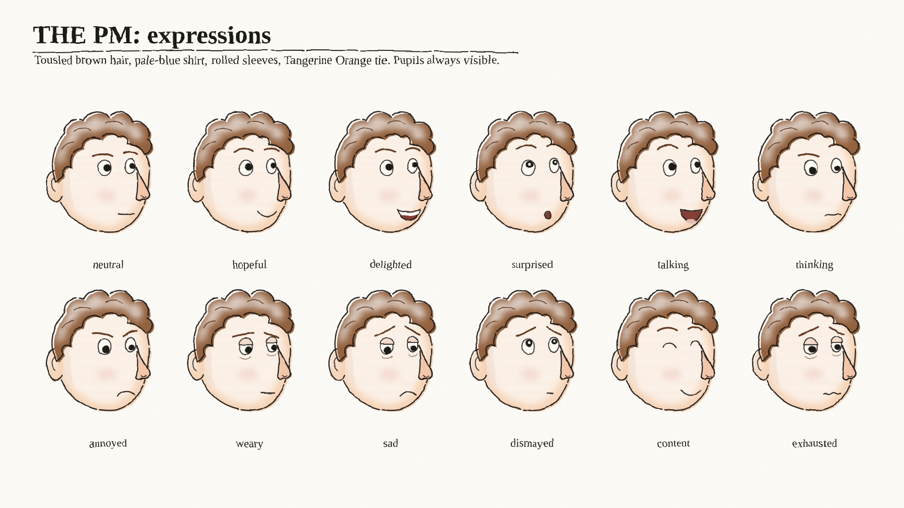
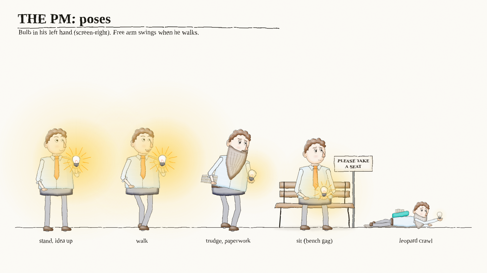
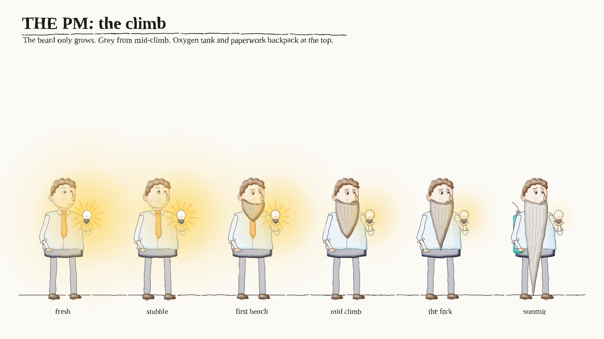
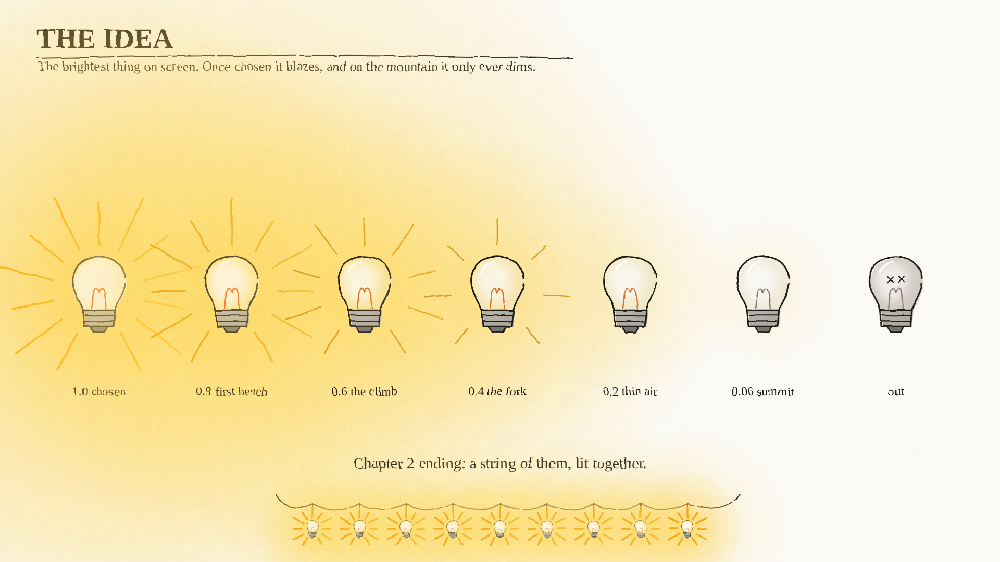
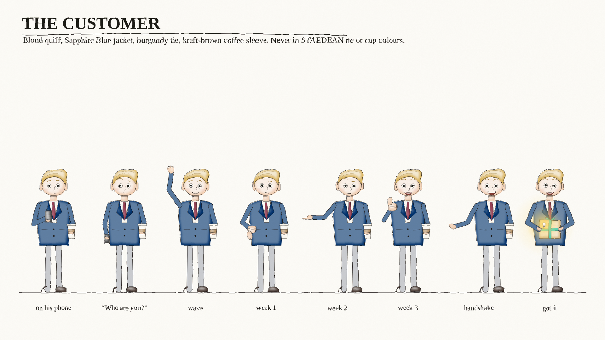
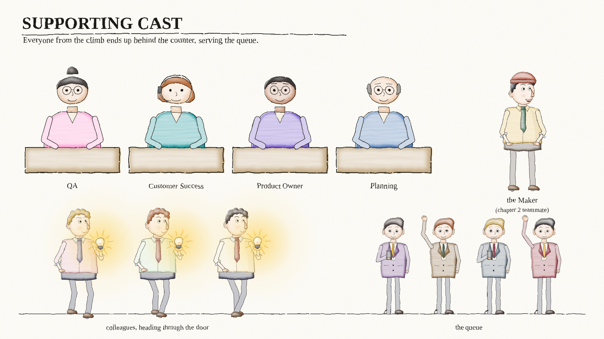
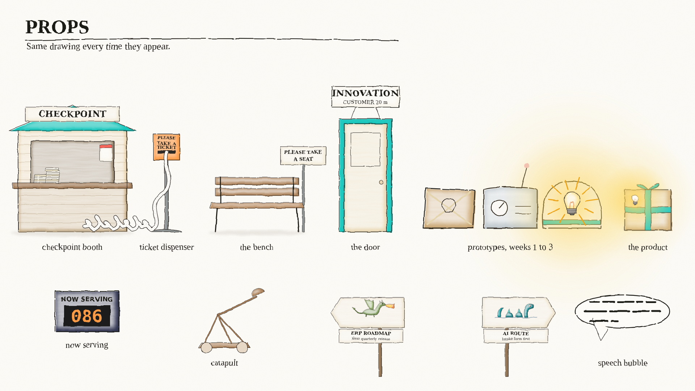
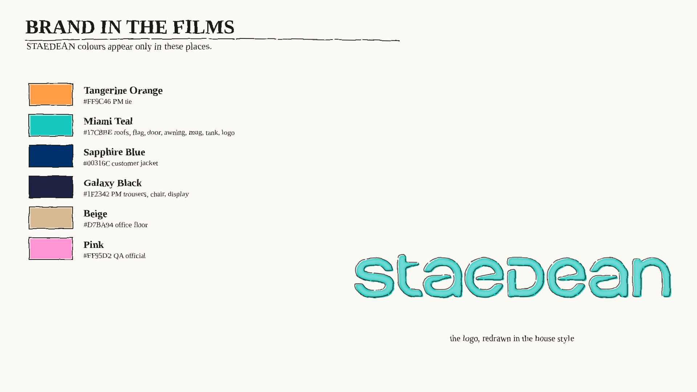

# THE CAST

The recurring characters, props and places from the STAEDEAN films. The implemented cast is drawn by code so designs stay consistent between appearances; the sheep's Lost Fleet reference is linked below. Change a shared drawing once and it changes everywhere it is reused.

## Canon and casting authority

This is the canonical character-profile and casting guide. Ken's direction of 2026-11-04 is explicit: **the ninja is the silent enemy**, and **the sheep is an occasional humorous character or Easter egg, not a universal mascot**. These rules supersede older "friendly courier" wording in handoffs, notes and source comments. Preserve the existing designs and recorded film actions; do not treat an old implementation comment as permission to reverse a character's role.

Read [the current handoff](../../../docs/CURRENT_HANDOFF.md) for selected cuts and the current clean ink-and-wash look (`rb.STYLE='wash'`). The older marker model sheets below remain identity references, not a direction to revert the accepted colouring. Film-specific actions do not create permanent biographies, allegiances or compulsory appearances. Names, private lives and affiliations not documented here are unspecified.

### Cast for the story

1. State the customer need, the setup, the gag and the consequence before choosing actors. Use the smallest cast that makes those beats clear.
2. Give every selected character a reason to be in that setting and an action consistent with their profile. An available drawing is not a casting reason.
3. Choose the PM, Maker, Customer Success or another established teammate when their role fits the protagonist's task. Nobody must lead every film. Do not silently relabel a familiar character as a new job or customer.
4. The ninja is an antagonist. Do not substitute him into the protagonist, STAEDEAN rescuer or product-solution role. Any exceptional protagonist/solution use must be explicitly justified by the story in the storyboard before production; it does not establish a new default identity.
5. Omit the sheep unless its appearance earns a specific joke in that setting. A cameo needs a reason too. No compulsory opening sheep, closing sheep or sheep in every customer story.
6. Keep the team well-intentioned. Their overcomplication and the system are the joke; the ninja's opposing role does not turn QA, Planning or another colleague into a villain.
7. Keep the story readable without sound. Prefer visual action and short signs over explanation. For new shorts, follow the current brief's duration (Ken's current request is 15–30 seconds); do not copy the long films' runtimes or expand a selected cut without a request.

### Before drafting shots

- **Do:** name each actor's role, immediate objective, visual reference, gag contribution and relationship to the customer.
- **Do:** distinguish an approved cut, a preview and a shelved experiment using the current handoff.
- **Do:** preserve hands, props, clothing, expressions and cause-and-effect across cuts.
- **Don't:** cast everyone merely to display the asset library, invent personal histories, or infer product capabilities from a visual metaphor.
- **Don't:** replace an appropriate employee with the ninja, use the sheep as a generic STAEDEAN representative, or make a customer's satisfaction proof that the ninja works for STAEDEAN.

The model sheets are in `assets/sheets/`. Regenerate them with `make sheets`.

Most shared drawing calls go through `src/cast.py`; the ninja currently has a separate helper linked in his profile. Coordinates are in a 1920 x 1080 frame. `(x, y)` is where the character's feet touch the ground unless noted.

```python
import os; os.environ["MS_STYLE"] = "wash"   # house look, set before importing
import cast
from render import render

art  = cast.pm(700, 900, pose="stand", mood="hopeful", bulb=1.0)
art += cast.customer(1250, 890, pose="thumbs_up", mood="delighted")
render([("my_frame", cast.frame(art))], "out")
```

Names: the characters are known by their roles for now. If they get names, add them here and as aliases in `cast.py`.

---

## The PM



**Role:** the hero. A product manager who has an idea and tries to get it to the customer. In film 1 he climbs Mount Staedean and fails. In film 2 he walks through the door and succeeds.

**Motivation and personality:** wants to get a useful idea to the customer. Hopeful, persistent and expressive; can become exhausted by process or carried away with an elaborate plan. These are on-screen behaviours, not a claim that he is always right.

**Do / appropriate uses:** lead idea-to-customer stories, carry an idea, visit and listen to the customer, pitch, wait, struggle, overplan, learn and react. The Perfect Bridge uses his oversized plan to hide the customer; The Priority lets his confidence become an awkward realisation.

**Don't / relationships:** do not make him an infallible saviour, malicious bureaucrat or the mandatory lead. The Maker is his equal teammate; the officials are colleagues, and the customer is the person he must understand. Preserve story-local ageing rather than making the summit beard his permanent identity.

**Design**

| Part | Look | Base colour in code | Final colour (marker look) |
|---|---|---|---|
| Hair | tousled, brown | `#7b4b2b` | `#8c5630` |
| Face | normal nose, pink cheeks, big round eyes | skin `#f0c9a6` | warm peach |
| Shirt | pale blue, sleeves rolled up | `#b9d3e6` | `#c3e2f4` |
| Tie | | `#c0623a` | **Tangerine Orange `#FF9C46`** |
| Trousers | | `#3a3a40` | **Galaxy Black `#1F2342`** |
| Shoes | brown | | |

**Calls**

```python
cast.pm(x, y, s=0.42, pose="stand", mood="hopeful", bulb=1.0, age="fresh",
        phase=0.0, mirror_it=False, stack=0, pack=0, tank=False)
cast.pm_head(x, y, s=1.0, mood="neutral", age="fresh")   # close-ups
```

- `pose`: `stand`, `walk`, `trudge`, `sit`, `crawl`
- `mood`: `neutral`, `hopeful`, `delighted`, `surprised`, `talking`, `thinking`, `annoyed`, `weary`, `sad`, `dismayed`, `content`, `exhausted`
- `age`: `fresh`, `stubble`, `first bench`, `mid climb`, `the fork`, `summit`, or your own `(beard, grey)` pair from 0 to about 1
- `phase`: walk cycle position in radians. Add about 0.75 per drawing for a steady walk.
- `stack`: number of sheets in his paperwork pile. `pack`: height of the paperwork backpack. `tank`: oxygen tank.




**Rules**

1. His pupils are always visible. Heavy lids never cover them.
2. He holds the idea in his **left hand**, which is screen-right when he faces right.
3. Paperwork is always on the other side.
4. The beard only grows within a story. Grey arrives from mid-climb.
5. Normal nose. The first big-nosed version was rejected.

---

## The idea



**Role:** the real main character. A light bulb.

**Motivation and personality:** a visual metaphor for an idea's vitality and progress, not a talking person with a private agenda. Its brightness carries the emotional state.

**Do / appropriate uses:** show hope, slow attrition, fast learning, competing priorities or collective success. The Priority's six good ideas can become a blinding distraction; in The Door, individuals including the customer carry bulbs together.

**Don't / relationships:** do not make the bulb a magic problem-solver or turn a dead idea back on to avoid a consequence. A replacement idea must read as a new one. The bulb is not exclusive to the PM and does not make its holder an ally: the ninja also carries one in The Priority.

```python
cast.idea(x, y, s=1.0, brightness=1.0, dead=False)
```

| Brightness | Meaning |
|---|---|
| 1.0 | just chosen. Rays, big glow. The brightest thing on screen. |
| 0.8 to 0.4 | the climb. Glow shrinks, rays thin out then vanish. |
| 0.2 to 0.06 | thin air. An ember. |
| 0.0 | off |
| `dead=True` | burnt out, filament broken, little crosses |

**Rules**

1. Nothing on screen is ever brighter than a live idea.
2. In a "death" story it only dims, never recovers.
3. In film 2 ideas can fail fast (fizzle into the LEARNED bin) and a new one lights straight away. Failing is fine, dying slowly is not.
4. The "together" ending is a string of bulbs, all lit.

---

## The customer



**Role:** the person all of this is for. In film 1 he is at the top of the mountain and has never heard of us ("Who are you?"). In film 2 he is 20 m away, gives honest feedback every week and ends up asking "When can I have it?".

**Motivation and personality:** wants something that meets his need. Direct, practical and capable of being puzzled, unimpressed or delighted. His feedback is honest, not obstruction for its own sake.

**Do / appropriate uses:** express a need, wait, reject a prototype, point out a useful change, accept a product, or reveal that the team missed the point. Keep his reactions legible and his coffee/phone/received item continuous.

**Don't / relationships:** do not turn him into a STAEDEAN employee, automatic fan or antagonist for declining an idea. A pleased response to the ninja's delivery does not make the ninja a STAEDEAN ally or establish customer disloyalty. The latest Door procession includes him with a bulb; that does not change his customer identity.

**Design**

| Part | Look | Colour |
|---|---|---|
| Hair | blond quiff | `#d9b25a` |
| Jacket | smart, lapels | **Sapphire Blue `#00316C`** (base `#4f7a5c` remapped) |
| Tie | | burgundy `#8e2f45` |
| Coffee | takeaway cup, kraft-brown sleeve `#b08a5a` | |
| Trousers | | slate `#323a48` |

```python
cast.customer(x, y, s=0.52, pose="phone", mood="neutral", look=(0, 0),
              blink=False, palette=None, coffee=True, box=False)
```

- `pose`: `phone`, `down`, `wave`, `thumbs_up`, `thumbs_down`, `point`, `shake`, `hold_box`
- `mood`: `neutral`, `happy`, `delighted`, `puzzled`, `unimpressed`, `talking`
- `palette`: override any of `JK` (jacket), `HR` (hair), `TIE`, `SK` (skin), `TR` (trousers). This is how the queue customers are made.

**Rules**

1. **He never wears STAEDEAN colours on his tie or cup.** Only the jacket is brand Sapphire. He is the customer, not one of us.
2. Thumbs are drawn wide and chunky so a thumbs-up never reads as a rude gesture. Keep it that way if you redraw hands.
3. He is front-facing. He only speaks one line per film.

---

## Supporting cast



### The four officials

Behind every counter. In film 1 they each stop the PM with a checkpoint. In film 2 they all stand together in the shop window, serving the customers, with their department plaques underneath.

| Department | Look | Top colour (marker look) | Call |
|---|---|---|---|
| QA | dark bun, glasses | Pink `#FF95D2` | `cast.official("qa", x, y)` |
| Customer Success | ginger bob, headset | dark teal `#008C94` | `cast.official("customer success", x, y)` |
| Product Owner | short dark hair, glasses | purple `#6749C9` | `cast.official("product owner", x, y)` |
| Planning | bald, grey sides, glasses | blue `#3d6fb0` | `cast.official("planning", x, y)` |

`gesture`: `rest`, `point_left`, `point_right`, `finger_up`. `mood`: `smile`, `flat`, `talk`, `o`. `(x, y)` is the counter top, not the feet: they are drawn from the chest up.

**Rule:** the officials are never villains. They are nice people doing their jobs inside a slow system. In film 2 the same people are the ones who make the product fly.

The following motivations are limited to the responsibilities and actions already shown. The films do not establish private histories, management hierarchies or rivalries between these four people. All four may carry ideas and walk with the ensemble, keeping their own heads, clothes and movement rather than becoming recoloured PMs.

#### QA

- **Role / motivation:** the QA checkpoint and later shop teammate; carries out the checking process, then helps serve customers.
- **Personality:** polite, procedural and well-intentioned. The checkpoint delay is a system joke, not cruelty.
- **Visual continuity:** dark bun, glasses, pink top; retain the supporting-sheet design when adding walking or carrying poses.
- **Do / scenes:** direct the PM to the ticket machine or bench in the mountain story; join delivery, idea and shop scenes where checking or participation matters. QA passes the package in The Handoff preview.
- **Don't / relationships:** no malicious gatekeeper, sabotage or invented feud with the PM. Both mountain routes converge on QA; QA is not the dragon or sea monster and is not allied with the ninja.

#### Customer Success

- **Role / motivation:** customer-facing teammate, a mountain checkpoint official and the lead of The Handoff preview; receives the customer's request/parcel and tries to carry it through.
- **Personality:** helpful and engaged, with readable puzzlement and a dry reaction when the process loses the point.
- **Visual continuity:** ginger bob, headset and dark-teal top. Preserve the microphone and its hand contact when it moves.
- **Do / scenes:** customer contact, handoffs, shop service, idea participation and a lead role when the gag concerns her work. Her look across/back and lowered mic conclude The Handoff preview.
- **Don't / relationships:** do not reduce her to background decoration or replace her with the PM/ninja by habit. She is a teammate of QA, PM, Maker and Planning, not the ninja's dispatcher. The Handoff is still a preview, not an approved template for every story.

#### Product Owner

- **Role / motivation:** product checkpoint and later shop teammate; handles the write-up in the mountain story and contributes an idea in The Priority.
- **Personality:** helpful and procedural; the expanding explanation/write-up belongs to the overcomplication joke.
- **Visual continuity:** short dark hair, glasses and purple top, distinct from the PM and QA.
- **Do / scenes:** product discussion, checkpoint write-ups, shop service and a justified ensemble idea beat.
- **Don't / relationships:** do not merge this identity with the PM, invent a boss/subordinate relationship, or portray the Product Owner as deliberately killing ideas. Shared work with the team does not require an appearance in every handoff.

#### Planning

- **Role / motivation:** planning checkpoint and later shop teammate; follows the process and contributes to the shared work.
- **Personality:** matter-of-fact and well-intentioned. Pointing to the bench before the PM speaks is the dry procedural gag.
- **Visual continuity:** bald head with grey sides, glasses and blue top.
- **Do / scenes:** waiting/scheduling process jokes, shop service, idea participation and the packaging chain. Planning looks into the empty box with Customer Success in The Handoff preview.
- **Don't / relationships:** do not invent authority over all colleagues or make Planning a hostile blocker. Keep the distinction between a slow system and a bad person.

### The Maker

The PM's teammate in film 2. One person who builds the prototypes while the PM goes to see the customer.

```python
cast.maker(x, y, s=0.42, mood="hopeful", phase=None)   # phase=None stands, a number walks
```

Dark hair, rust beanie, mustard shirt, green tie. Same body as the PM so they read as equals.

**Motivation and personality:** wants to build and improve something useful. Practical, constructive and capable of a deadpan reaction; the simple plank in The Perfect Bridge contrasts with the PM's enormous blueprint.

**Do / appropriate uses:** make prototypes, hammer improvements after feedback, offer a practical solution, carry an idea, or participate in a justified team handoff.

**Don't / relationships:** do not replace the Maker with the ninja for a convenient solution, make the Maker the PM's servant, or invent effortless technical powers. The PM and Maker collaborate; customer feedback drives their iteration.

### Colleagues

Three recoloured versions of the PM body, each with their own idea. They walk through the door at the end of film 2 to show this is how everyone works now.

```python
cast.colleague(i, x, y, s=0.42, phase=0.0, bulb=0.8)   # i = 0, 1, 2
```

**Motivation and personality:** hopeful participants bringing their own ideas; no individual biographies or distinct personalities have been established for indices 0, 1 and 2.

**Do / appropriate uses:** use the three existing palette variants consistently for background idea participation or the original Door ending. Retain the PM-based silhouette and each variant's palette; they are colleagues, not three copies of the same PM.

**Don't / relationships:** do not silently substitute them for QA, Customer Success, Product Owner, Planning or Maker. The selected Door cut uses the seven identified cast members in its procession; the older colleague-only version is not the current staging.

### The queue

The market. Customer bodies with different jackets, hair and ties (`film2.QUEUE`). Use `cast.customer(..., palette=film2.QUEUE[i])`.

**Motivation and personality:** customers waiting to be served; a varied market, not named individuals with established biographies. Use ordinary waiting and pleased reactions without assigning a permanent temperament to a palette.

**Do / appropriate uses:** shop/customer-demand scenes where a queue communicates the story. Preserve each selected palette across shots and the customer-body design.

**Don't / relationships:** do not confuse these palette variants with the principal blond customer or STAEDEAN colleagues, make them a mandatory cheering crowd, or cast an incidental queue figure as a named specialist without establishing that role.

---

## The ninja

**Role:** the **silent enemy**, a recurring antagonist. He is not the helpful hero, a STAEDEAN employee or an automatic rescuer.

**Motivation and personality:** quiet, economical and unobtrusive in the existing delivery scenes. For future casting, his actions must serve his opposing role, not solve STAEDEAN's problem on the team's behalf. No personal history, employer, named competitor, secret allegiance or detailed motive is established.

**Visual continuity:** reuse `ninja()` in [the existing ninja director](../../the-priority-ninja/director.py). Charcoal hood and clothes, darker belt, headband tails, visible eye opening and expressive eyes; no weapons in the established design. The smiling eyes in the existing cut are an expression, not evidence of a friendly allegiance. There is no ninja wrapper in `cast.py` or dedicated model sheet yet.

**Do / appropriate uses:**

- Use him when an opposing presence or the team being quietly outmanoeuvred is the point of the gag.
- Preserve the existing Priority delivery and the team's awkward reaction. Under Ken's clarified role, stage future uses so that the audience can read the team's loss of the initiative.
- Keep him silent. Let timing, looks, the customer interaction and the team's reaction communicate the consequence.

**Don't / relationships:**

- Do not have him arrive as "our STAEDEAN hero", magically unify information, repair the team's process or demonstrate the product as a friendly solution provider.
- Do not infer that he is on the team because the customer is pleased. Serving a customer's need can be part of an antagonist's action while leaving STAEDEAN outmanoeuvred.
- Do not invent violence, weapons, sabotage, a redemption arc or a specific rival company from the word "enemy".
- Do not insert him into every film. An exceptional protagonist/solution role requires explicit story justification in the storyboard, not asset reuse or a vague "ninja efficiency" metaphor.

**Existing-film constraint:** The Priority visibly shows him handing over the matching bulb, followed by the desk team's awkward glances. The Handoff preview shows him delivering the original parcel while Customer Success faces the empty packaging. These are recorded actions, not proof that he is a helpful teammate. Keep the approved Priority cut and the unapproved status of The Handoff; this documentation update does not rewrite either film. Older source comments calling him a friendly courier describe an earlier interpretation and are not casting authority.

## The sheep

**Role:** humorous character and occasional Easter egg, **not a universal mascot** or default STAEDEAN representative. This role is Ken's explicit direction of 2026-11-04.

**Motivation and personality:** the supported scope is comic/absurdist use. No fixed personal objective, job, biography, allegiance or detailed temperament is established in this repository.

**Visual continuity:** the driving sheep now has a concrete reference in [The Lost Fleet director](../../lost-fleet/director.py), functions `sheep()` and `dumper()`, and [the rendered driver still](../../../outputs/The-Lost-Fleet-sheep-v1.png). Preserve the cream fleece, warm grey/tan face and ears, round eyes, dark hooves and existing ink-and-wash treatment. The mustard hard hat and yellow dumper belong to this rental-yard gag; they do not establish a permanent job or uniform. Ken explicitly requested committing this film with the driving sheep on 2026-11-04. Reuse this drawing when a future brief earns a sheep appearance; consult Ken before a substantive redesign.

**Do / appropriate uses:** use an occasional sheep gag or background Easter egg only when the setting and payoff explain why it is there. State that reason in the storyboard. Omission is the default when it adds no joke.

**Don't / relationships:** no sheep in every episode, scene, end card or customer story; no automatic sheep customer, employee, hero or product demonstrator. Do not infer an alliance with the ninja or team. The Lost Fleet appearance does not establish permanent costume, occupation or setting rules. The Bigger Picture correctly uses only the customer and Customer Success.

## Other established creature imagery

These are bounded visual gags, not interchangeable recurring heroes. No personal motivation, biography or relationship beyond the stated metaphor is established.

| Figure | Role, personality and appropriate use | Visual continuity | Do / don't and story constraints |
|---|---|---|---|
| Dragon | Ominous ERP ROADMAP route imagery in Mount Staedean; a comic warning about the route. | Green dragon with wings and fire in `props.dragon`; the fork also has a smoky lair/eyes. | Keep it tied to that route metaphor. Do not invent a named villain, an alliance with the ninja, or a dragon solution-provider. Both routes still reach QA. |
| Sea monster | Ominous AI ROUTE imagery at the same fork; the alternative is no escape from process. | Blue-grey, long-necked creature with humps, fins and waterline in `props.sea_monster`. | Keep the AI-route association and existing drawing. Do not make it a pet, mascot, teammate or literal claim about AI capability. |
| "MOVE FAST" snail | Static office-poster irony about speed, with no independent agency or personality established. | Preserve the poster drawing in `src/office.py`. | Use as set dressing where the office poster belongs. Do not promote it into a new recurring actor without a new brief. |

## Casting failure example: the Rental IQ draft

Ken identified two errors in the proposed Rental IQ treatment: it made the ninja a helpful hero who brought chaotic information together, and inserted the sheep gratuitously. This is a rejected casting pattern, not a new episode establishing canon. It is distinct from The Lost Fleet, whose sheep-driving reveal is the explicitly requested central gag, and The Bigger Picture, which casts Customer Success as the helper and the customer as decision maker.

- **Wrong:** "Reuse the friendly ninja" as the STAEDEAN solution, plus sheep cameos simply because they are familiar.
- **Right:** choose a customer-facing protagonist and solution action justified by the brief and the profiles above; include the ninja only if his opposing role serves the story. Omit the sheep unless a specific setting-based gag needs it.
- Do not infer Rental IQ features from that draft or from these characters. Confirm the product action separately before promising it on screen.

## Where the profile rules come from

- [Mount Staedean story bible](FILM1_MOUNT_STAEDEAN.md) and [The Door story bible](FILM2_THE_DOOR.md): original roles, relationships and story-local continuity. Their older runtimes and marker look are historical.
- [Model sheets](../assets/sheets/) and [shared cast calls](../src/cast.py): visual identities, palette variants and supported drawing controls. The current wash treatment is set by the [current handoff](../../../docs/CURRENT_HANDOFF.md).
- [Selected Door procession notes](../../../outputs/The-Door-everyone-has-an-idea-notes.md): seven identified walkers, each with a bulb.
- [Selected Bridge notes](../../../outputs/The-Perfect-Bridge-binoculars-v2-notes.md): selected short gag and shelved expansion boundary.
- [Priority ninja notes](../../../outputs/The-Priority-ninja-v2-notes.md) and [final reaction notes](../../../outputs/The-Priority-awkward-glances-v6-notes.md): existing design, delivery and awkward reaction.
- [The Handoff preview notes](../../../outputs/The-Handoff-gag-v1-notes.md): Customer Success lead, packaging chain and reaction; still a first preview.
- Ken's explicit 2026-11-04 correction supplies the ninja's silent-enemy role and the sheep's occasional-use rule. It overrides earlier helpful-hero assumptions without inventing identities or changing approved animation.

**Documentation flow:** root README / AGENTS → this guide for casting → current handoff for cut status and entry points → film notes and existing drawing helpers for implementation. When changing a character rule, update this guide first and reconcile active handoff wording. Historical notes remain evidence of what was drawn, not permission to contradict current canon.

---

## Props



| Prop | Where it lives | Notes |
|---|---|---|
| Checkpoint booth | `props.booth_back` / `booth_front` | Teal roof. Sign text is a parameter. Wall calendar inside. |
| Ticket dispenser | `props.dispenser` | "PLEASE TAKE A TICKET". The strip loops on the floor when it whirrs too long. |
| Now serving | `props.now_serving` | 086, then 087, then 088. Later booths show 412. |
| The bench | `props.bench` / `bench_front` | "PLEASE TAKE A SEAT". Creak and a ticking clock every time someone sits. |
| Speech bubble | `props.bubble` | Lines, not words. Nobody speaks real words except the customer. |
| Signposts | `props.signpost` | The fork: ERP ROADMAP (dragon) and AI ROUTE (sea monster). |
| The door | `film2.door` | Small, teal frame. "INNOVATION / CUSTOMER 20 m". Flips to "HOW WE WORK". |
| Prototypes | `film2.proto(x, y, v)` | v1 cardboard box, v2 box with a dial and aerial, v3 lit dome. |
| The product | `film2.product_box` | Kraft box with teal ribbon and a glow. |
| LEARNED bin | `film2.learned_bin` | Where failed week-one ideas go. Fast failure is good. |
| Catapult | `film2.catapult` | Week 4. Throws the product over Mount Staedean. |
| Week cards | `film2.day_card` | WEEK 1 to WEEK 4. |
| Paperwork | `rig.paper_stack`, `rig.backpack` | Grows with every checkpoint. |
| Oxygen tank | `rig.oxygen_tank` | Teal. Summit only. |

## Places

| Place | Code | Seen in |
|---|---|---|
| The office | `office.py` (`back_wall`, `window`, `desk_top`, `calendar`, "MOVE FAST" snail poster) | Both films |
| Mount Staedean | `sets.big_mountain` | Through the office window. 20,000 m. Both films. |
| Checkpoint ledge | `sets.ledge` | Film 1 |
| The slope | `sets.slope` | Film 1 |
| The fork | `sets.fork_set` | Film 1 |
| The summit | `sets.summit_set` | Film 1 |
| The path to the customer | `film2.path_set` | Film 2. 20 m long, sunny, a parasol and a table. |
| The shop | `film2` shot `S1_now_open` | Film 2 |

---

## Brand colours



STAEDEAN colours are used sparingly and only in these places, so they feel like a wink rather than an advert.

| Colour | Hex | Used for |
|---|---|---|
| Tangerine Orange | `#FF9C46` | PM tie |
| Miami Teal | `#17C8BE` | Checkpoint roofs, summit flag, PM mug, oxygen tank, the door, shop awning, the logo |
| Sapphire Blue | `#00316C` | Customer jacket |
| Galaxy Black | `#1F2342` | PM trousers, office chair, displays |
| Beige | `#D7BA94` | Office floor |
| Pink | `#FF95D2` | QA official |
| Purple | `#6749C9` | Product Owner |
| Dark teal | `#008C94` | Customer Success |

The rig draws in a neutral base palette. `src/rb.py` maps base colours to the final ones (`CMAP`), and the colours that must stay strong under the marker texture are listed in `BRAND_STRONG`. To recolour something for every film at once, change the map, not the drawing.

## The logo

`assets/logo/staedean_logo_clean.svg` is the vector, traced from the brand logo. `src/logo_path.py` holds the same path for code. In the films it is drawn in the house style: teal fill slightly offset, broken pen outline, a string of lit bulbs above.

## Rental shorts added 2026-11-04

- **The Bigger Picture (28 s, 4:5):** the blond customer represents the rental business. Customer Success retains her ginger bob, headset and teal top, introduces comparative information, and acknowledges the customer's own equipment choice. ERP availability stays correct; no automated allocation or predictive maintenance. [Storyboard](../../bigger-picture/storyboard.md).
- **The Lost Fleet (25 s, 16:9):** the customer looks for equipment, the Maker uses the established binoculars and tablet, and the hard-hat sheep drives a dumper for the montage's absurd reveal. Its ending callback is specific to this gag. The map explicitly shows recorded location history. [Storyboard and product check](../../lost-fleet/storyboard.md).
- Keep these as separate films. Neither changes the ninja's silent-enemy role or requires a sheep in other shorts.
